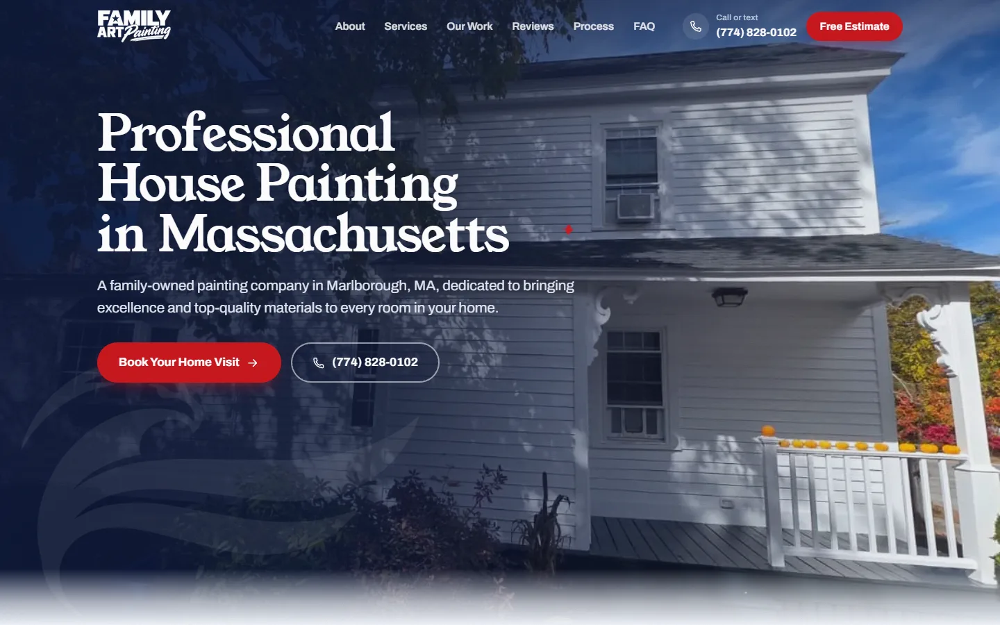
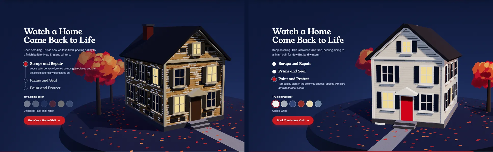
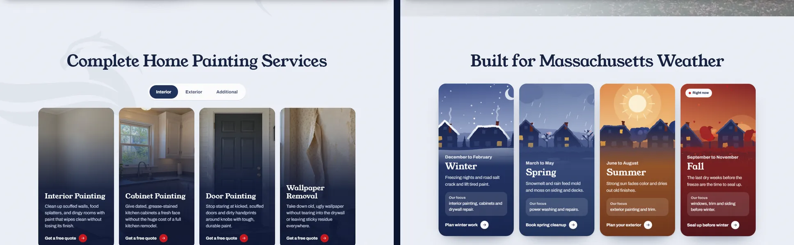
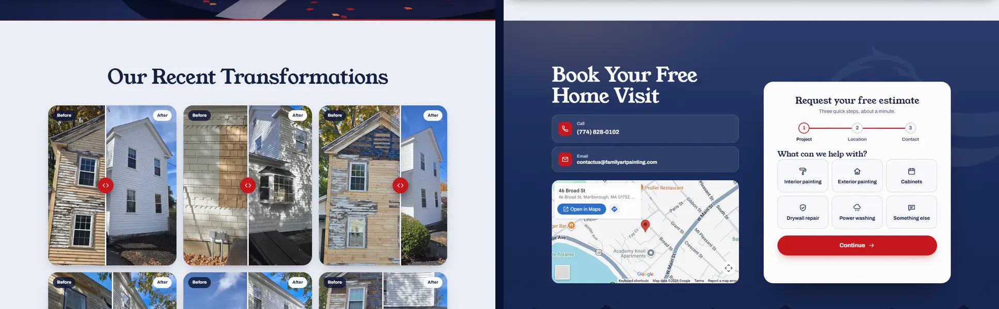
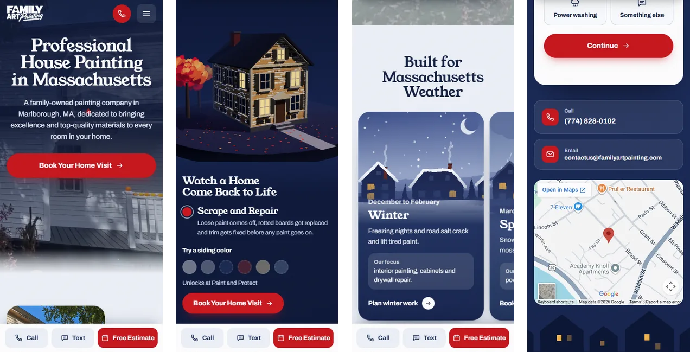

<div align="center">


# Family Art Painting

**Site institucional one page para uma empresa familiar de pintura residencial em Marlborough, Massachusetts.**

Um dia numa rua da Nova Inglaterra: foto real no topo, uma casa colonial que se repinta em 3D no scroll e um orçamento em três passos.

[](https://family.escolats.com.br/)


</div>

<br>



## Sobre o projeto

A Family Art Painting é tocada por um casal, Leonardo e Josilaine, que está saindo da subcontratação para conquistar clientes próprios. O site existe para uma coisa: transformar o homeowner que chega pelo Google Ads ou pelo Google Business Profile em uma visita marcada, uma ligação ou uma mensagem de texto.

| | |
|---|---|
| **Cliente** | Family Art Painting Inc, 46 Broad St, Marlborough, MA |
| **Público** | Homeowners americanos em Massachusetts, a maioria no celular |
| **Objetivo** | Conversão: formulário, ligação ou SMS para (774) 828-0102 |
| **Idioma do site** | Inglês (EUA) |
| **Agência** | [Eu Sou TS](https://eusouts.com.br/) |

## Destaques

- **Seção 3D com Three.js.** A casa colonial fica fixa na tela e é repintada conforme o scroll: madeira descascada, primer e acabamento, com um rolo 3D passando na parede. No fim, seis chips trocam a cor do siding em tempo real. Acabamento pictórico feito em shader, com textura de papel.
- **Antes e depois interativo.** Seis pares de fotos reais do projeto com slider arrastável, que também funciona por toque e por teclado.
- **Orçamento em três passos.** Serviço em cards clicáveis, local e prazo, e contato, com barra de progresso, validação por passo e serviço pré-selecionado pelos links dos cards.
- **Estações da Nova Inglaterra.** Quatro cards ilustrados, um para cada estação. A estação atual é detectada sozinha e recebe o selo "Right now".
- **Contato em toda a tela.** Barra fixa no mobile com Call, Text e Free Estimate, que sai de cena quando o formulário aparece.
- **Marca d'água da águia do logo** em várias seções, sempre sutil.

<br>







<div align="center">
  
</div>

## Identidade visual

| Token | Cor | Uso |
|---|---|---|
| Night | `#0b1533` | Céus, rodapé, fundos escuros |
| Navy | `#1f3159` | Texto forte, botões secundários |
| Maple | `#c8161c` | Ação: botões, links, estado ativo |
| Amber | `#f2b24a` | Só onde algo acende: janelas, foco |
| Haze | `#eef2f8` | Fundo das seções claras |

**Tipografia:** Young Serif nos títulos e Archivo em todo o resto, as duas hospedadas no próprio site. O sistema completo está em [DESIGN.md](DESIGN.md).

## Estrutura

```
.
├── index.html              Página única
├── 404.html                Página de erro
├── .htaccess               URLs limpas, HTTPS, cache, segurança, antispam
├── robots.txt              Robôs no domínio final
├── robots-staging.txt      Bloqueia robôs no ambiente de teste
├── sitemap.xml             Página e imagens principais
├── site.webmanifest        App na tela inicial
├── humans.txt / llms.txt   Créditos e resumo para IAs
├── favicon.ico + PNGs      Ícones de navegador, Apple e Android
├── assets/
│   ├── css/styles.css
│   ├── js/main.js          Interações, formulário, antispam
│   ├── js/repaint.js       Cena 3D (Three.js via CDN)
│   ├── fonts/              Young Serif e Archivo (woff2)
│   └── img/                Logos, ilustrações das estações, OG image
├── images/                 Fotos reais do projeto (WebP)
│   ├── generated/          Imagens dos cards de serviço geradas por IA (ver README e manifest.json)
│   └── stock/              Fotos do Unsplash da primeira versão, sem uso atual
├── tools/cache-bust.mjs    Atualiza a versão de CSS e JS
└── docs/                   Imagens deste README
```

## Rodando localmente

Não tem build. Qualquer servidor estático serve:

```bash
npx serve .
# ou
python -m http.server 8080
```

As URLs limpas e o restante do `.htaccess` só funcionam em Apache.

## Deploy

1. Suba o conteúdo da pasta para a raiz do Apache. As pastas `Logos/`, `tools/` e `docs/` podem ficar de fora; mesmo que subam, o `.htaccess` responde 404 nelas.
2. O `.htaccess` força HTTPS, remove o `www` e nunca mostra `.html` na URL.
3. No domínio `*.escolats.com.br`, o site responde com `noindex` e um robots que bloqueia tudo, para o ambiente de teste não aparecer no Google.

### Limpar o cache depois de uma atualização

O HTML é sempre revalidado. CSS e JS ficam em cache por 1 ano e levam `?v=` no `index.html`. Depois de alterar qualquer um deles, rode:

```bash
node tools/cache-bust.mjs
```

e suba o `index.html` junto com os arquivos alterados.

### Formulário

Abra `assets/js/main.js` e preencha `FORM_ENDPOINT` com um endpoint do [Formspree](https://formspree.io/) ou similar. Sem ele, o envio abre o app de e-mail do visitante com o pedido preenchido.

### Antispam

- Campo invisível `_gotcha` (o Formspree também filtra por ele)
- Envios com menos de 4 segundos de interação são descartados
- Mensagens com links são descartadas, e o robô recebe um falso "Thank you"
- O e-mail não aparece inteiro no HTML; o JavaScript monta o link
- O `.htaccess` recusa robôs conhecidos que coletam e-mails

## Antes de publicar

- [ ] Substituir os 3 depoimentos marcados como `[Placeholder]` pelos reviews reais do Google
- [ ] Confirmar com o cliente o selo "Licensed and insured"
- [ ] Configurar o `FORM_ENDPOINT`
- [ ] Validar as cidades atendidas e o link do Facebook
- [ ] Trocar as imagens geradas por IA dos cards de serviço (`images/generated/`) por fotos reais quando o cliente enviar
- [ ] No lançamento, trocar `family.escolats.com.br` por `familyartpainting.com` em `index.html`, `sitemap.xml`, `robots.txt` e `llms.txt`

## Créditos

Design e desenvolvimento por **[Eu Sou TS](https://eusouts.com.br/)**.
Fotos dos projetos e do portfólio: Family Art Painting. Imagens dos cards de serviço: geradas por IA para ilustrar cada serviço; não são registros de trabalhos da empresa.

<div align="center">
<br>
<sub>© 2026 Family Art Painting Inc. Todos os direitos reservados.</sub>
</div>
